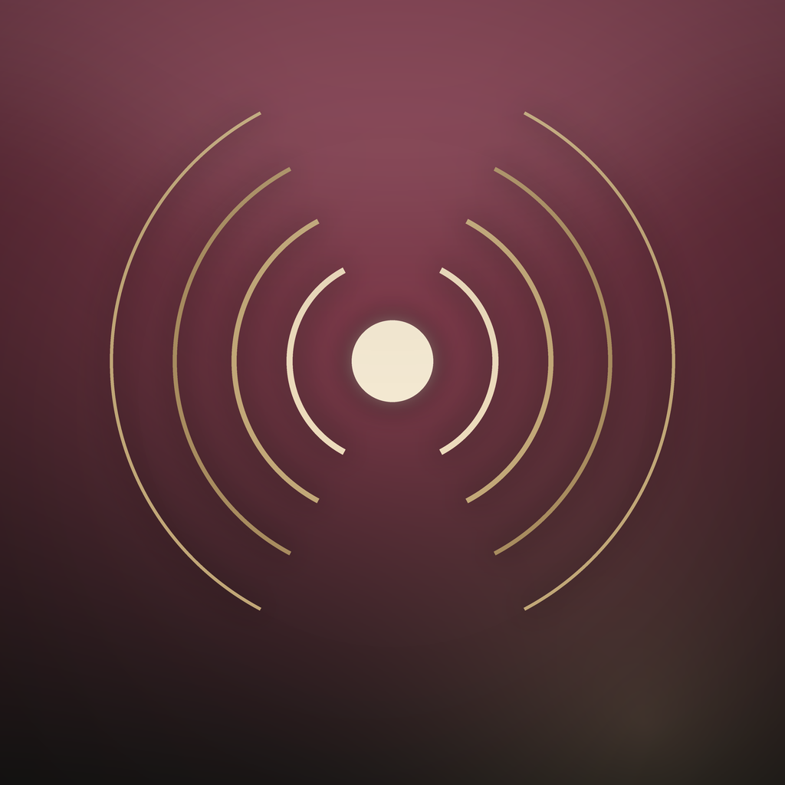

<p align="center">
  
</p>

<h1 align="center">vibration</h1>

<p align="center">
  Нативное iOS-приложение: телефон вибрирует в такт басам музыки,<br/>
  а вторая вкладка превращает iPhone в 3D-сканер глубины с тактильным «парктроником».
</p>

<p align="center">
  <a href="https://github.com/homik-ori/vibration/releases/latest"></a>
  <a href="https://github.com/homik-ori/vibration/actions/workflows/build_ipa.yml"></a>
  
  
  
</p>

<p align="center">
  <b>by homik</b> · iPhone XS Max и все более новые модели · 60/120 FPS
</p>

---

## Возможности

| | |
|---|---|
| 🎧 **Музыка** | Импорт `.mp3`, `.wav`, `.m4a`, `.flac`, `.aiff` через системный `fileImporter`; файл копируется в приватную папку приложения. |
| 🎛 **Плеер** | Обложка с анимированным градиентом, пульсирующим в такт басам, таймлайн с текущим/общим временем, play/pause, перемотка ±15 с. |
| 📳 **Движок вибрации** | `AVAudioEngine` → tap → 2048-точечный real FFT на `vDSP`; энергия полосы 30–150 Гц сравнивается с адаптивным уровнем низа трека; удар баса → `CHHapticEngine` `hapticTransient`. Сила зависит от громкости удара и множителя из настроек, cooldown 80 мс против «захлёбывания» мотора. |
| 📡 **Задний LiDAR** | `ARWorldTrackingConfiguration` + `sceneReconstruction(.mesh)` на iPhone 12 Pro и новее: расстояние до стены/предмета по перекрестию, точечная визуализация сцены во время сканирования. |
| 🙂 **Фронтальный TrueDepth** | `ARFaceTrackingConfiguration` на XS Max, 11, 12, 13, 14, 15, 16 и др.: расстояние от экрана до лица по `ARFaceAnchor`. |
| 🔀 **Умное определение датчиков** | Есть оба — появляется переключатель «Задний LiDAR / Фронтальный». На XS Max автоматически включается фронтальный сканер. |
| 🚗 **Тактильный парктроник** | Чем ближе объект или лицо, тем чаще лёгкие тики через Taptic Engine (от ~620 мс на 1.2 м до ~100 мс на 12 см). |
| ⚙️ **Настройки** | «Сила вибрации» 10–100 %, «Резкость отклика» 0–1, «Чувствительность к басу» 0–1, тест Taptic Engine, карточка «О приложении» со ссылками на репозиторий и релиз. |
| 🔋 **Энергосбережение** | При уходе с вкладки `ARSession` ставится на паузу, а `AVAudioEngine` останавливается: камера и CPU не греются. |

## Стек

`Swift 5` · `SwiftUI` · `AVFoundation` · `Accelerate (vDSP FFT)` · `Core Haptics` · `ARKit` · `SceneKit`

Минимальная версия — **iOS 15.0**, архитектура **arm64**, только iPhone (портретная ориентация).
Вёрстка адаптируется под все диагонали: от «чёлки» XS Max до Dynamic Island 16/17 Pro Max.

## Установка

Неподписанная сборка (`CODE_SIGNING_ALLOWED=NO`) ставится с вашим Apple ID:

1. Скачайте **`vibration.ipa`** из [Releases](https://github.com/homik-ori/vibration/releases/latest)
   (прямая ссылка: `https://github.com/homik-ori/vibration/releases/latest/download/vibration.ipa`).
2. Установите через **AltStore**, **SideStore** или **Sideloadly**.
3. На iPhone: `Настройки → Основные → VPN и управление устройством` → доверьтесь профилю разработчика.

Камера запрашивается при первом открытии вкладки «Лидар».
Музыку можно импортировать кнопкой «+» или через «Файлы» → `На моём iPhone` → `vibration`.

## Сборка

Проект описан в [`project.yml`](project.yml) (XcodeGen) — `.xcodeproj` не хранится в репозитории,
он генерируется на CI, поэтому проектный файл всегда соответствует спеке.

```bash
brew install xcodegen
xcodegen generate

xcodebuild archive \
  -project vibration.xcodeproj -scheme vibration -configuration Release \
  -destination 'generic/platform=iOS' -archivePath build/vibration.xcarchive \
  CODE_SIGN_IDENTITY="" CODE_SIGNING_REQUIRED=NO CODE_SIGNING_ALLOWED=NO

mkdir -p build/Payload
cp -R build/vibration.xcarchive/Products/Applications/vibration.app build/Payload/
(cd build && /usr/bin/zip -r -y vibration.ipa Payload)
```

CI — [`.github/workflows/build_ipa.yml`](.github/workflows/build_ipa.yml): `macos-latest`, XcodeGen → `xcodebuild archive`
→ `Payload/vibration.app` → `vibration.ipa` → GitHub Release + artifact.

## Структура

```
vibration/
├── project.yml                     # XcodeGen spec (iOS 15.0, iPhone, unsigned-friendly)
├── Support/Info.plist              # NSCameraUsageDescription, LSSupportsOpeningDocumentsInPlace…
├── vibration/
│   ├── App/                        # точка входа, TabView, тема, AppInfo
│   ├── Audio/                      # AVAudioEngine, BassAnalyzer (vDSP), HapticsManager, AudioLibrary
│   ├── Scanner/                    # DepthScannerController (ARKit) + ARSCNView bridge
│   ├── Settings/                   # AppSettings (UserDefaults)
│   └── Views/                      # экраны трёх вкладок и компоненты
├── scripts/make_icon.py            # генерация иконки 1024×1024
└── .github/workflows/build_ipa.yml
```

## Как это работает

**Бас → вибрация.** Tap снимает буфер с миксера, копия буфера уходит на последовательную очередь,
где `vDSP_fft_zrip` считает спектр 2048 точек. Сумма бинов до 150 Гц переводится в дБ и сравнивается
с медленным асимметричным средним (быстро вниз, медленно вверх). Превышение порога на 3–15 дБ
(порог задаёт слайдер чувствительности) — это удар; сила удара нормируется и умножается на «силу вибрации»,
резкость уходит в `hapticSharpnessControl` уже запущенного transient-плеера. Пересоздание паттерна
на каждый удар не требуется — только динамические параметры, поэтому всё остаётся в 120 FPS.

**Глубина → расстояние.** В заднем режиме ARKit строит меш сцены, а луч из центра экрана
(`raycastQuery(from:allowing:.estimatedPlane)`) даёт мировую точку; расстояние — модуль разницы
с позицией камеры. Во фронтальном режиме `ARFaceAnchor.transform` даёт z-координату лица относительно
камеры. Оба значения сглаживаются EMA (0.7/0.3) и опрашиваются 20 раз в секунду, а не на каждом кадре —
это бережёт главный поток.

## Лицензия

[MIT](LICENSE) © 2026 homik. Проект не связан с Apple; ARKit, Core Haptics и названия устройств —
торговые марки Apple Inc.
